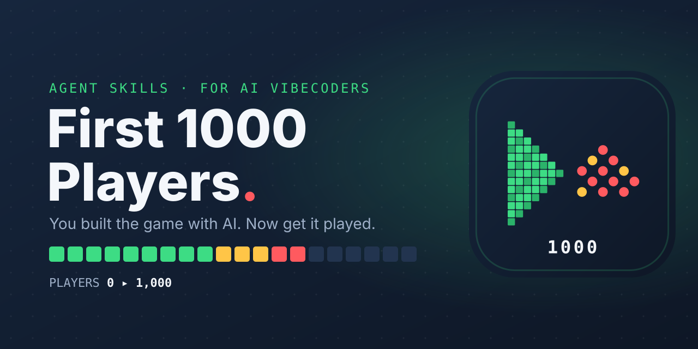
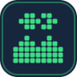
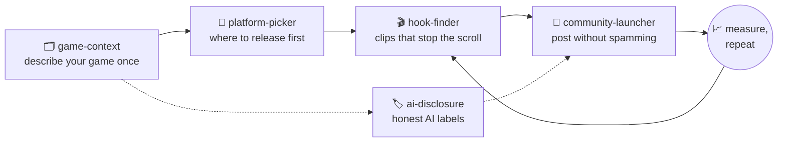
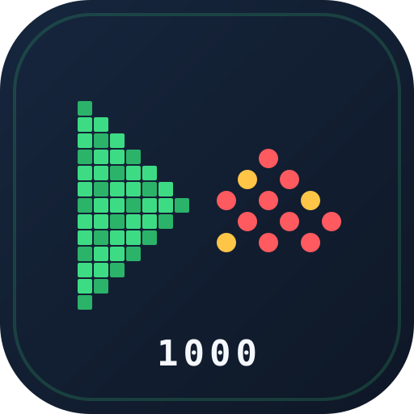

<div align="center">



<br>

[](https://github.com/nguyenbui1105/first-1000-players/actions/workflows/validate.yml)
[](https://agentskills.io)
[](#-install)
[](#-the-skills)
[](LICENSE)
[](CONTRIBUTING.md)

**English** · [Tiếng Việt](README.vi.md)

**You built the game with AI. Now get it played.**

[The skills](#-the-skills) · [Install](#-install) · [How it works](#-how-it-works) · [Case study](#️-case-study) · [Roadmap](#️-roadmap)

</div>

---

## 🎯 Why this exists

AI made building games cheap. Attention didn't get any cheaper.

<table>
<tr>
<td align="center" width="33%"><h3>24,000+</h3>games launched on Steam in 2026 so far (~78 a day)</td>
<td align="center" width="33%"><h3>39%</h3>of them disclose generative AI (nearly 50% in October)</td>
<td align="center" width="33%"><h3>~$1,700</h3>median lifetime gross of a paid 2026 release, so far</td>
</tr>
</table>

<sub>Data to early November 2026. Sources and caveats in <a href="references/market.md">references/market.md</a>.</sub>

Marketing skill packs exist for SaaS. Game-dev skill packs exist for writing code. **First 1000 Players** covers the step in between: **distribution for small, AI-built games**. That means web portals, itch.io, Steam, short video, communities, and the AI-disclosure question every vibecoder now faces.

## 🧩 The skills

| | Skill | Use it when you want to… |
|:-:|---|---|
|  | [**game-context**](skills/game-context/SKILL.md) | describe your game once, so every other skill knows its genre, audience, platforms and AI usage |
|  | [**platform-picker**](skills/platform-picker/SKILL.md) | decide where to release first (CrazyGames, Poki, itch.io, Steam) and what comes next |
|  | [**hook-finder**](skills/hook-finder/SKILL.md) | find the moments strangers stop scrolling for and cut them into TikTok / Shorts clips |
|  | [**community-launcher**](skills/community-launcher/SKILL.md) | share your game on Reddit, Discord and local groups without breaking rules (drafts only) |
|  | [**ai-disclosure**](skills/ai-disclosure/SKILL.md) | write honest AI disclosures for Steam, itch.io and Reddit, and reduce backlash |

## ⚡ Install

**Claude Code (plugin)**
```
/plugin marketplace add nguyenbui1105/first-1000-players
/plugin install first-1000-players@first-1000-players
```

**Any agent that supports the open [Agent Skills](https://agentskills.io) standard**
```bash
npx skills add nguyenbui1105/first-1000-players
```

<details>
<summary><b>Manual install</b></summary>

Copy the folders inside `skills/` into:

| Agent | Folder |
|---|---|
| Claude Code | `.claude/skills/` (project) or `~/.claude/skills/` (global) |
| Codex | `.agents/skills/` |
| Cursor | `.cursor/skills/` |

</details>

## 🔁 How it works

Open your game project with your agent and say **"Help me find my first players."**



Every skill reads the same `.agents/game-context.md`, so you explain your game once. Skills answer in **the language you write in**.

## 🧭 Principles

| | |
|---|---|
| ✍️ **Drafts, not bots** | Skills never post, comment or DM for you. You publish. |
| 🏷️ **Honest about AI** | No skill helps hide AI use. Getting caught hiding it does more damage than saying it up front. |
| 📅 **Numbers with dates** | Every benchmark has a source and a `last_checked` date, and skills remind you to verify. |
| 🎲 **No viral promises** | Viral stories are survivors. Skills set realistic gates and measure. |
| 🌏 **Your language** | Docs in English and Vietnamese. More translations welcome. |

## 🌶️ Case study

Every skill is tested first on a real game: a **first-person pepper-farming game set in Đắk Lắk, Vietnam**. The public diary in [`case-studies/pepper-farm-daklak`](case-studies/pepper-farm-daklak/README.md) logs every clip, post and number, bad ones included.

Have your own results? [Add your case study](CONTRIBUTING.md#case-studies).

## 🗺️ Roadmap

- [x] `game-context` · `platform-picker` · `hook-finder` · `community-launcher` · `ai-disclosure`
- [ ] `steam-page-wishlist`: store page audit, tags, demo, Next Fest, Personal Calendar
- [ ] `web-portal-publisher`: CrazyGames / Poki / itch.io requirements, WebGL size checks
- [ ] `feedback-analytics`: minimal events, funnels, drop-off points
- [ ] `launch-checklist` · `devlog-buildinpublic` · `creator-outreach`
- [ ] `sea-vietnam-playbook`: Vietnamese and Southeast Asian communities, events, rules

## 📁 Repo layout

```
skills/          one folder per skill: SKILL.md + references/ + scripts/
references/      shared market data with sources
evals/           3+ test prompts per skill
scripts/         validate_skills.py (runs in CI)
case-studies/    real distribution diaries
assets/          logo, banner, icons
```

## 🤝 Contributing

Updated a community's rules? Got a case study? Found an outdated number? See [CONTRIBUTING.md](CONTRIBUTING.md) and run `python3 scripts/validate_skills.py` before opening a PR.

<div align="center">
<br>

<br>
<sub>MIT License · Made in Vietnam 🇻🇳 for vibecoders everywhere</sub>
</div>
