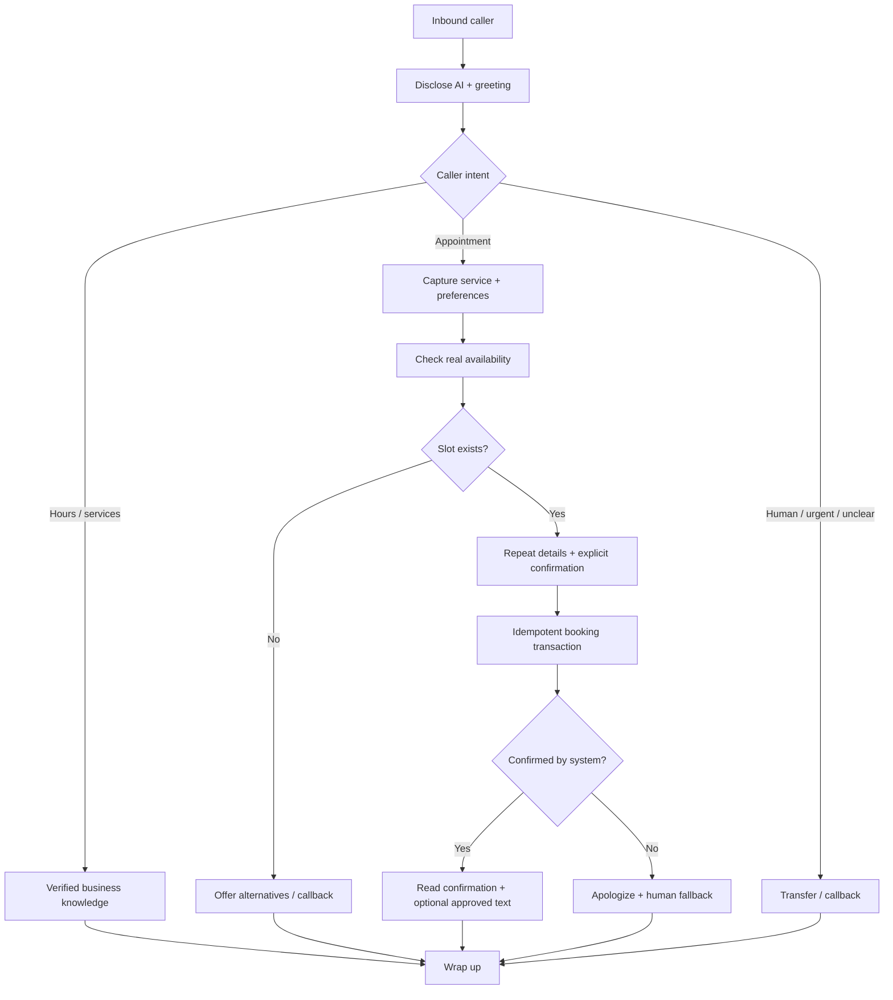

# ☎️ ReceptionistOS — AI Call Agent Skill Kit

> **Turn missed calls into completed service requests, without pretending the AI is human.**

**Research-backed · Provider-neutral · Business-configurable · Test-first**

[Architecture](docs/ARCHITECTURE.md) · [Skills](skills/README.md) · [Demo](docs/DEMO.md) · [Production checklist](docs/PRODUCTION.md) · [Sources](docs/RESEARCH.md)

## The problem

A business misses a call. The caller asks about hours, books a service, describes a car, or needs to speak with a person. A fluent voice model alone is **not** a reliable receptionist: business actions require validated facts, consent, transaction safety, and human fallbacks.

## What this project delivers

- **10 portable agent skills** with triggers, contracts, instructions, failure paths and acceptance checks.
- A **deterministic Python orchestration core** (standard library; no paid API keys to test).
- A **local JSON business profile** and a pluggable availability / booking / transfer boundary.
- **Call-flow simulation** plus automated unit tests.
- Deployment guidance for **Vapi / Retell-style platforms or OpenAI SIP** — these are integration options, **not implemented live telephony**.
- Built-in safety posture: disclose AI, never fabricate availability, never say “booked” before a successful reservation, escalate uncertainty, minimize personal data.

### Workflow



### Quick start (offline, safe)

Requires Python 3.11+; **no pip install**.

```bash
python -m unittest discover -s tests -v
python -m receptionist.cli
```

Example simulation: “I'd like an oil change” → collect customer details → use provided demo slots → confirm → book. **Demo slots and records are fake and never contact real customers.**

### Project layout

```text
receptionist/          Deterministic engine, mock booking system, demo CLI
skills/                Portable skills / SKILL.md playbooks
businesses/            Editable sample business config (fictional)
tests/                 Behavior + failure scenario tests
docs/                  Architecture, research, deployment, evaluation
.github/workflows/     Standard-library CI checks
```

## Product boundaries

| Layer | Recommended responsibility | Included? |
|---|---|---|
| Voice transport | PSTN, SIP, barge-in, speech I/O | Design only |
| Conversation model | Natural language and tool selection | Prompt contract only |
| Skill / policy layer | Business rules, safeguards, fallbacks | **Yes** |
| Orchestration core | State transitions, booking guardrails | **Yes (demo)** |
| Real integrations | CRM, calendar, SMS, transfer | Interface, not live |
| Analytics | Quality gates, KPIs, evaluation | Framework |

**Important:** This is a reusable *starter kit*, not a production telephone service. A real deployment requires an approved phone provider, integration credentials, consent review, data governance, monitoring, and load tests.

## Why not reproduce the viral “$6,000 agent” claim?

The screenshot describes a service-advisor flow, **not an independently validated cost, pricing, or revenue benchmark**. Treat the amount as marketing copy, not evidence of development cost or agent quality. We focus on measurable performance: booking accuracy, escalation success, latency, incident rate, and business value.

## Business niches

Designed for salons, florists, auto service shops, repair businesses, and other appointment-driven SMBs. **Regulated health, legal, financial and emergency handling need separate professional reviews; do not enable those by changing a prompt alone.**

## Roadmap

- [x] Research and provider comparison
- [x] Portable skills and contracts
- [x] Offline reference engine + tests
- [ ] Real calendar transactional adapter + concurrency tests
- [ ] Voice provider webhook / SIP adapter
- [ ] Secure SMS / CRM integrations
- [ ] Multilingual speech evaluations, observability dashboard
- [ ] Pilot with consented test callers

## License

MIT. Built for education and prototyping. See [SECURITY.md](SECURITY.md) before live deployment.
