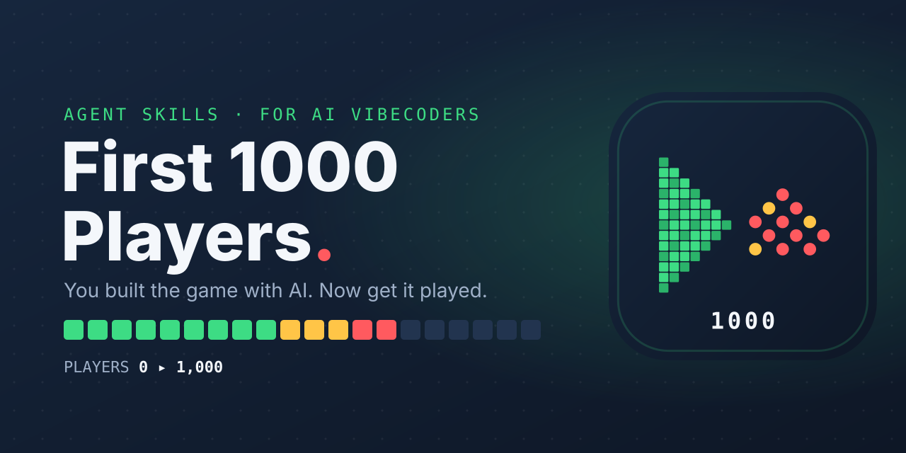
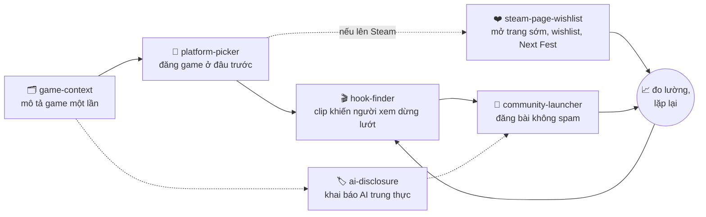
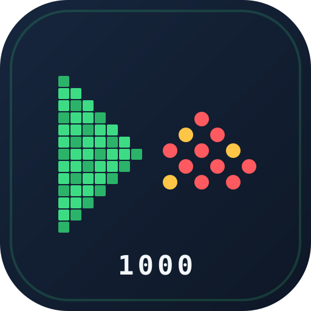

<div align="center">



<br>

[](https://github.com/nguyenbui1105/first-1000-players/actions/workflows/validate.yml)
[](https://agentskills.io)
[](#-cài-đặt)
[](#-các-skill)
[](LICENSE)
[](CONTRIBUTING.md)

[English](README.md) · **Tiếng Việt** · [+ thêm ngôn ngữ của bạn](docs/i18n/README.md)

**Bạn đã làm game bằng AI. Giờ hãy đưa game đến người chơi.**

[Các skill](#-các-skill) · [Cài đặt](#-cài-đặt) · [Cách hoạt động](#-cách-hoạt-động) · [Case study](#️-case-study) · [Lộ trình](#️-lộ-trình)

</div>

---

## 🎯 Vì sao có repo này

AI giúp làm game rẻ hơn rất nhiều, nhưng sự chú ý của người chơi thì không rẻ đi.

<table>
<tr>
<td align="center" width="33%"><h3>24.000+</h3>game ra mắt trên Steam từ đầu năm 2026 (~78 game mỗi ngày)</td>
<td align="center" width="33%"><h3>39%</h3>trong số đó khai có dùng AI tạo sinh (gần 50% trong tháng 10)</td>
<td align="center" width="33%"><h3>~$1.700</h3>doanh thu trung vị tính đến nay của game trả phí ra năm 2026</td>
</tr>
</table>

<sub>Số liệu đến đầu tháng 11/2026. Nguồn và lưu ý tại <a href="references/market.md">references/market.md</a>.</sub>

Đã có bộ skill marketing cho SaaS, đã có bộ skill để code game. **First 1000 Players** lo đúng khâu ở giữa: **phân phối cho game nhỏ làm bằng AI**. Đó là web portal, itch.io, Steam, video ngắn, cộng đồng, và câu hỏi "có nên khai dùng AI không" mà vibecoder nào cũng gặp.

## 🧩 Các skill

| | Skill | Dùng khi bạn muốn… |
|:-:|---|---|
|  | [**game-context**](skills/game-context/SKILL.md) | mô tả game một lần, để mọi skill khác biết thể loại, người chơi mục tiêu, nền tảng và việc dùng AI |
|  | [**platform-picker**](skills/platform-picker/SKILL.md) | chọn nơi phát hành trước (CrazyGames, Poki, itch.io, Steam) và bước tiếp theo |
|  | [**hook-finder**](skills/hook-finder/SKILL.md) | tìm khoảnh khắc khiến người lạ dừng lướt và cắt thành clip TikTok / Shorts |
|  | [**community-launcher**](skills/community-launcher/SKILL.md) | giới thiệu game trên Reddit, Discord, nhóm Việt Nam mà không vi phạm luật (chỉ soạn nháp) |
|  | [**ai-disclosure**](skills/ai-disclosure/SKILL.md) | viết phần khai báo AI trung thực cho Steam, itch.io, Reddit và giảm phản ứng tiêu cực |
|  | [**steam-page-wishlist**](skills/steam-page-wishlist/SKILL.md) | mở trang Steam sớm, kiểm tra ảnh capsule và tag, lên kế hoạch wishlist, demo và Next Fest |

## ⚡ Cài đặt

**Claude Code (plugin)**
```
/plugin marketplace add nguyenbui1105/first-1000-players
/plugin install first-1000-players@first-1000-players
```

**Agent hỗ trợ chuẩn mở [Agent Skills](https://agentskills.io)**
```bash
npx skills add nguyenbui1105/first-1000-players
```

<details>
<summary><b>Cài thủ công</b></summary>

Chép các thư mục trong `skills/` vào:

| Agent | Thư mục |
|---|---|
| Claude Code | `.claude/skills/` (theo project) hoặc `~/.claude/skills/` (dùng chung) |
| Codex | `.agents/skills/` |
| Cursor | `.cursor/skills/` |

</details>

## 🔁 Cách hoạt động

Mở project game cùng agent và gõ **"Giúp tôi tìm những người chơi đầu tiên cho game."**



Mọi skill đọc chung file `.agents/game-context.md`, nên bạn chỉ cần mô tả game một lần. Skill trả lời **theo ngôn ngữ bạn viết**.

## 🧭 Nguyên tắc

| | |
|---|---|
| ✍️ **Soạn nháp, không làm bot** | Skill không bao giờ tự đăng bài, bình luận hay nhắn tin thay bạn. Bạn là người đăng. |
| 🏷️ **Minh bạch về AI** | Không skill nào giúp che giấu việc dùng AI. Bị phát hiện che giấu còn tệ hơn tự khai. |
| 📅 **Số liệu có ngày** | Mọi con số đều có nguồn và ngày kiểm tra (`last_checked`), và skill luôn nhắc bạn kiểm tra lại. |
| 🎲 **Không hứa viral** | Câu chuyện viral là của số ít người may mắn. Skill đặt mục tiêu thực tế và đo lường. |
| 🌍 **Toàn cầu** | Skill trả lời theo ngôn ngữ bạn viết. Danh sách cộng đồng theo khu vực và bản dịch do người đóng góp khắp thế giới bổ sung. |

## 🌶️ Case study

Case study đầu tiên là game của chính người duy trì repo: **game trồng tiêu góc nhìn thứ nhất lấy bối cảnh Tây Nguyên, Việt Nam**. Nhật ký công khai tại [`case-studies/pepper-farm-daklak`](case-studies/pepper-farm-daklak/README.md) ghi lại mọi clip, bài đăng và con số, kể cả số liệu xấu.

Mục tiêu là có một thư viện case study từ nhiều quốc gia, thể loại và engine. [Thêm case study của bạn](CONTRIBUTING.md#case-studies).

## 🗺️ Lộ trình

- [x] `game-context` · `platform-picker` · `hook-finder` · `community-launcher` · `ai-disclosure`
- [x] `steam-page-wishlist`: kiểm tra trang Steam, kích thước ảnh capsule, wishlist, demo, Next Fest, Personal Calendar
- [ ] `web-portal-publisher`: yêu cầu của CrazyGames / Poki / itch.io, kiểm tra dung lượng WebGL
- [ ] `feedback-analytics`: sự kiện tối thiểu, funnel, điểm người chơi bỏ cuộc
- [ ] `launch-checklist` · `devlog-buildinpublic` · `creator-outreach`
- [ ] `regional-playbooks`: cộng đồng, sự kiện, festival và quy định phát hành theo từng quốc gia (bắt đầu với Việt Nam; [thêm khu vực của bạn](CONTRIBUTING.md#regional-communities))

## 📁 Cấu trúc repo

```
skills/          mỗi skill một thư mục: SKILL.md + references/ + scripts/
references/      số liệu thị trường dùng chung, có nguồn
evals/           ít nhất 3 câu test cho mỗi skill
scripts/         validate_skills.py (chạy tự động trên CI)
case-studies/    nhật ký phân phối thật
assets/          logo, banner, icon
```

## 🤝 Đóng góp

Cập nhật luật của một cộng đồng? Biết các cộng đồng làm game ở nước bạn? Có case study? Thấy số liệu đã cũ? Xem [CONTRIBUTING.md](CONTRIBUTING.md) và chạy `python3 scripts/validate_skills.py` trước khi mở PR.

<div align="center">
<br>

<br>
<sub>Giấy phép MIT · Xây dựng công khai cho vibecoder khắp thế giới 🌍</sub>
</div>
