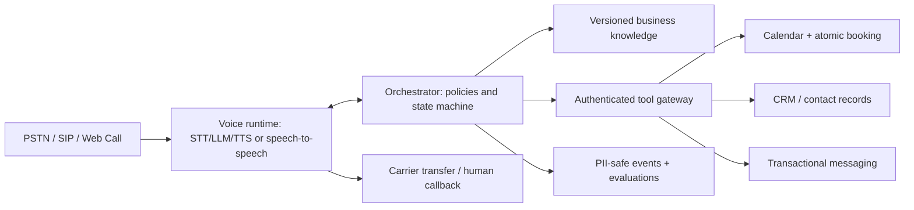

# Architecture

## Separation of concerns

## Domain invariants

1. AI identity disclosure precedes business actions.
2. Spoken availability is sourced from a live authoritative availability API. Never guess.
3. Calendar bookings require caller read-back and explicit positive confirmation.
4. Booking must be atomic and idempotent; the in-memory reference implementation is illustrative, **not production-safe under concurrency**.
5. A transfer attempt is not equal to a human answering.
6. Policy cannot be bypassed by user utterances or retrieved documents.
7. Vendor tool arguments must be validated at an authenticated server boundary.
8. No recording or retention without deployment-specific policy and appropriate consent.

## Event model

`call.started`, `ai.disclosed`, `intent.classified`, `slots.returned`, `caller.confirmed`, `booking.succeeded`, `booking.failed`, `transfer.requested`, `transfer.answered`, `call.ended`.

Emit **identifiers and redacted metadata**, not raw phone numbers, VINs, payment details or full transcripts by default.

## API boundary (suggested)

- `GET /v1/services`
- `POST /v1/availability {service_id, window_start, window_end, location_id}`
- `POST /v1/bookings {service_id, slot_id, customer, confirmed, idempotency_key}`
- `POST /v1/handoffs {reason, call_id}`
- `POST /v1/messages {template_id, destination, authorization_reference}`

Use signed webhook validation, token scopes, rate limits, audit events, timeouts and retry policy. Never trust model-generated `confirmed=true` without independently recorded user approval.

## Design decision

**Fastest pilot:** Vapi/Retell managed telephony with your own deterministic tool gateway.

**Greater control:** SIP carrier + OpenAI realtime voice + sideband tool backend. This increases responsibility for transport, events, reliability and cost.

**Vendor neutral:** Business profiles and policy skills remain independent of the speech provider.
